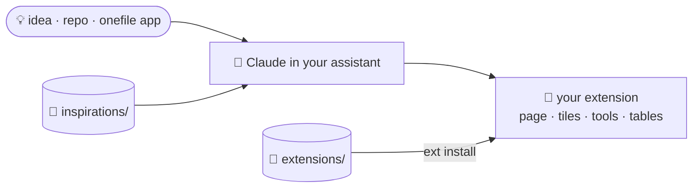

<div align="center">


# Beni Assistant · Extensions

### The apps for [Beni Assistant](https://github.com/b-niamin/assistant), your self-hosted assistant.

Install a ready-made one, or let Claude build yours from an inspiration.

[Extensions](#-ready-to-use) · [Inspirations](#-inspirations) · [Install](#-install) · [Build your own](#-build-your-own)


</div>

## 🧩 Ready to use

<table>
  <tr>
    <td width="33%" valign="top">
      <a href="docs/screenshots/health.png"></a>
      <h3>🏃 <a href="extensions/health">Training &amp; Health</a></h3>
      Garmin sleep, HRV, Body Battery, readiness and activities with route, laps and charts.<br />
      <sub><code>health</code> · native · per profile · needs Garmin Connect</sub>
    </td>
    <td width="33%" valign="top">
      <a href="docs/screenshots/gym.png"></a>
      <h3>🏋️ <a href="extensions/gym">Gym Tracker</a></h3>
      Plan workouts, log sets and weights, see your progress and the muscles you trained.<br />
      <sub><code>gym</code> · onefile · per profile</sub>
    </td>
    <td width="33%" valign="top">
      <a href="docs/screenshots/home.png"></a>
      <h3>💡 <a href="extensions/home">Home</a></h3>
      A calm board for the house: lights, doors and windows, camera alerts, weather and today's calendar.<br />
      <sub><code>home</code> · native · shared · needs Home Assistant</sub>
    </td>
  </tr>
</table>

<details>
<summary>📸 More screenshots, light and dark</summary>

| Light | Dark |
|---|---|
|  |  |
|  |  |
|  |  |

An activity in Training & Health:


</details>

<sub>All screenshots use demo data.</sub>

## 💭 Inspirations

Skeletons Claude copies and adapts to you; they are not installed as they are.

| | Inspiration | Shows how to |
|---|---|---|
| 🏡 | [`home-assistant`](inspirations/home-assistant) | Shared data and a settings panel with a token (the ready-made `home` grew from it) |
| 📅 | [`calendar`](inspirations/calendar) | Shared data, dashboard tiles |
| 🧠 | [`learning`](inspirations/learning) | Per-profile data, dashboard tiles, a daily streak |

Anything else can be an inspiration too: someone's repo, an app from
[onefile-apps](https://github.com/b-niamin/onefile-apps), an idea. Claude builds the extension fresh and
records the source as `inspiredBy`.

## 🚀 Install

With a new Beni Assistant:

```sh
curl -fsSL https://raw.githubusercontent.com/b-niamin/assistant/main/install.sh | sudo sh -s -- health gym home
```

In a running one: **System settings → Extend the system**, or ask Claude *"add the gym tracker"*.
By hand and updating: [docs/install.md](docs/install.md).

## 🔧 Build your own

Ask Claude in your assistant: *"build me a habit tracker inspired by &lt;link&gt;"*. It starts from an
inspiration (`ext new <id> --from inspiration:<name>`), wears the app's look and puts Beni in.



What a folder holds: [docs/extension-layout.md](docs/extension-layout.md). The full contract:
[spec 002](https://github.com/b-niamin/assistant/blob/main/specs/002-extensions.md) in the core repo.
To publish one here, add its folder and an entry in [`catalog.json`](catalog.json).
