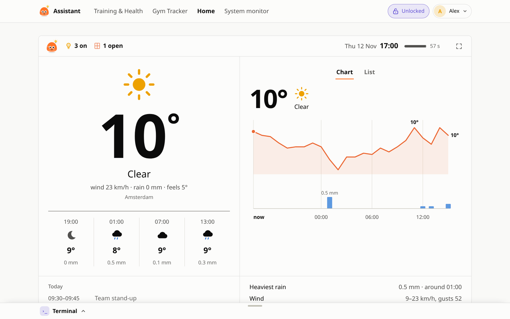
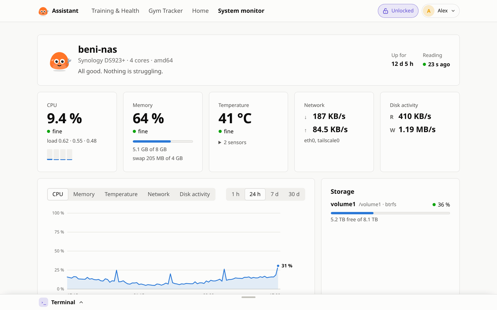
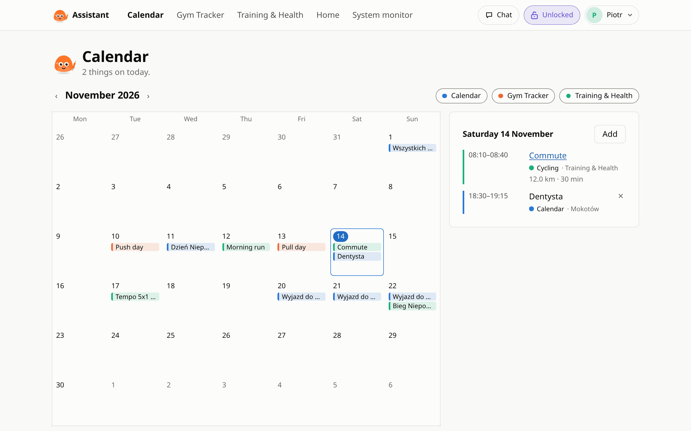
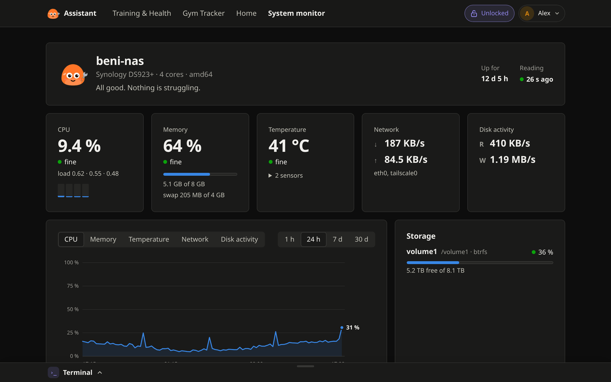
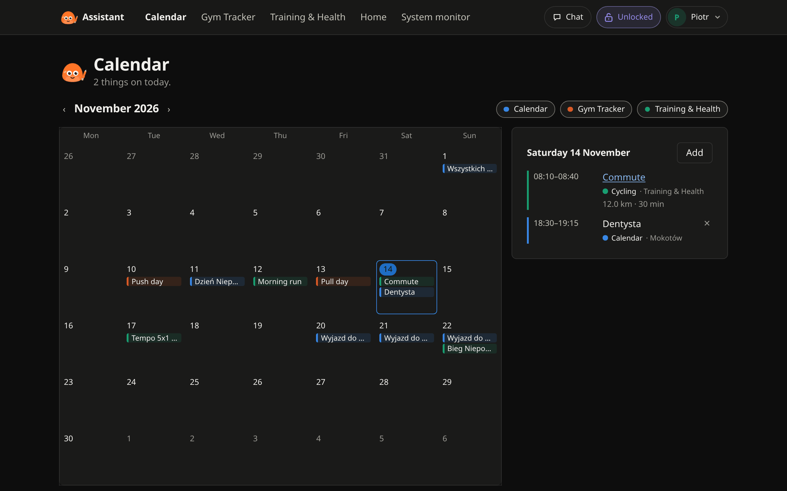
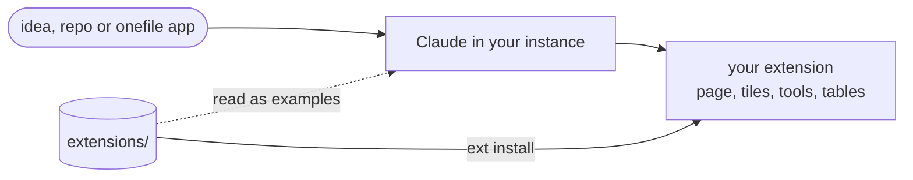

<div align="center">


# Beni Assistant extensions

Extensions for [Beni Assistant](https://github.com/b-niamin/assistant).
`extensions/` holds ones you install as they are, and the working examples Claude reads when it builds a new one.

[Ready to use](#ready-to-use) · [Install](#install) · [Write your own](#write-your-own)

</div>

## Ready to use

<table>
  <tr>
    <td width="50%" valign="top">
      <a href="docs/screenshots/health.png"></a>
      <h3><a href="extensions/health">Training &amp; Health</a></h3>
      Sleep, HRV, Body Battery, readiness and activities with route, laps and charts, synced from Garmin.<br />
      <sub><code>health</code> · native · per profile · needs a Garmin Connect account</sub>
    </td>
    <td width="50%" valign="top">
      <a href="docs/screenshots/gym.png"></a>
      <h3><a href="extensions/gym">Gym Tracker</a></h3>
      Workout plans, sets and weights, progress charts and a body map of trained muscles.<br />
      <sub><code>gym</code> · onefile · per profile</sub>
    </td>
  </tr>
  <tr>
    <td valign="top">
      <a href="docs/screenshots/home.png"></a>
      <h3><a href="extensions/home">Home</a></h3>
      Lights on, open doors and windows, camera alerts, weather with warnings and today's calendar.<br />
      <sub><code>home</code> · native · shared · needs Home Assistant</sub>
    </td>
    <td valign="top">
      <a href="docs/screenshots/monitor.png"></a>
      <h3><a href="extensions/monitor">System monitor</a></h3>
      CPU, memory, temperature, disks, network and containers of the machine the assistant runs on, with history.<br />
      <sub><code>monitor</code> · native · shared</sub>
    </td>
  </tr>
  <tr>
    <td valign="top">
      <a href="docs/screenshots/calendar.png"></a>
      <h3><a href="extensions/calendar">Calendar</a></h3>
      One calendar for the house: own entries, subscribed calendars (Google, iCloud, Outlook) and what the other apps put on it.<br />
      <sub><code>calendar</code> · native · shared</sub>
    </td>
    <td valign="top"></td>
  </tr>
</table>

<details>
<summary>More screenshots, light and dark</summary>

| Light | Dark |
|---|---|
|  |  |
|  |  |
|  |  |
|  |  |
|  |  |

An activity in Training & Health:


</details>

<sub>Screenshots use demo data.</sub>

## Tools for Claude

Each extension adds tools to the assistant's MCP server, which Claude uses from claude.ai (the Claude
connector) or from the app's terminal. Besides the generic ones (`describe` and `query`, or `read_data`
and `write_data`):

| Extension | Reads | Writes |
|---|---|---|
| `health` | `health__overview`: latest metrics, daily series, recent activities | `health__add_journal_entry` |
| `gym` | `gym__overview`: plans, this week against the goal, recent workouts with sets | `gym__log_workout`, `gym__save_plan` |
| `home` | `home__overview`: lights, doors and windows, alerts, weather, today's calendar | `home__configure` (what the board watches; `home__entities` lists ids) |
| `calendar` | `calendar__overview`: the coming days from every app on the calendar; `calendar__entries` for any range | `calendar__add_entry`, `calendar__update_entry`, `calendar__remove_entry` |
| `monitor` | `monitor__overview`: CPU, memory, temperature, disks, network, containers now; `monitor__history` | none |

The contract (`web/tools.server.ts`, a read-only `overview`, one tool per write):
[spec 005](https://github.com/b-niamin/assistant/blob/main/specs/005-claude-tools.md).

Things with a date go on the shared calendar the same way: `web/calendar.server.ts` (gym workouts, health
activities and Garmin plans, Home Assistant calendars), shown by the Calendar app
([spec 002, "Calendar entries"](https://github.com/b-niamin/assistant/blob/main/specs/002-extensions.md)).

## Install

With a new Beni Assistant:

```sh
curl -fsSL https://raw.githubusercontent.com/b-niamin/assistant/main/install.sh | sudo sh -s -- health gym home monitor calendar
```

In a running instance: **System settings → Extend the system**, or ask Claude *"add the gym tracker"*.
Command-line install and updates: [docs/install.md](docs/install.md).

## Write your own

Ask Claude in your instance, e.g. *"build me a habit tracker based on &lt;link&gt;"*. A repo, an app from
[onefile-apps](https://github.com/b-niamin/onefile-apps) or a description is the starting point; Claude
writes the extension from scratch, reads a ready-made one here as a working example (`home`: a connected
service with a token, `health`: per-profile data with tiles), uses the app's layout and components, and
records the source as `inspiredBy`.



Folder layout: [docs/extension-layout.md](docs/extension-layout.md). Full contract:
[spec 002](https://github.com/b-niamin/assistant/blob/main/specs/002-extensions.md) in the core repo.
To publish an extension here, add its folder and run `node scripts/build-catalog.mjs`, which remakes
[`catalog.json`](catalog.json) from the manifests.

## Languages

Every extension here speaks English and Polish. Texts sit in the code in English and are translated in
`i18n/<lang>.json` ([spec 007](https://github.com/b-niamin/assistant/blob/main/specs/007-languages.md)).
When your instance uses a language an extension lacks, Claude translates it on install;
`ext languages` lists the gaps. The store listing takes its name, description and `needs` from the same files.
