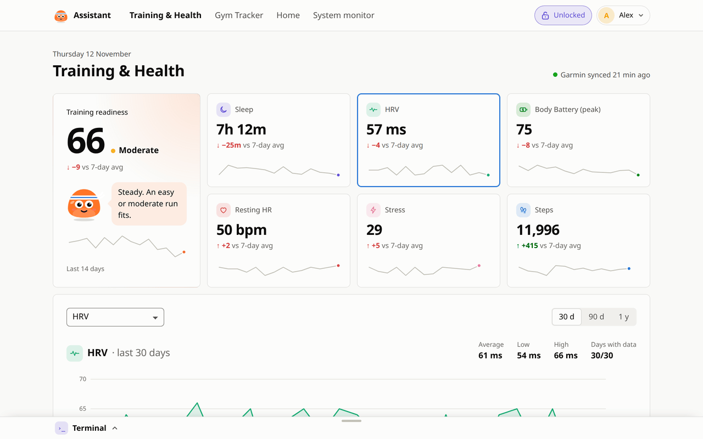
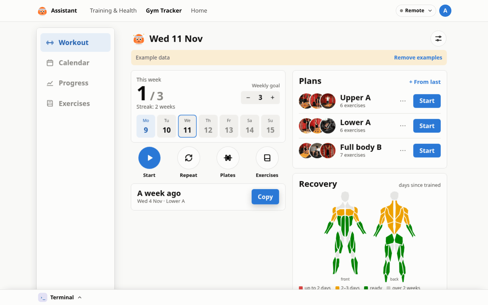
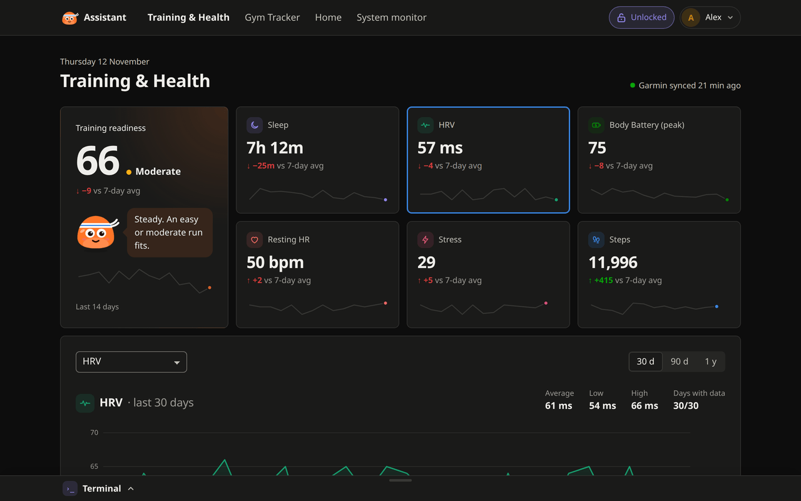
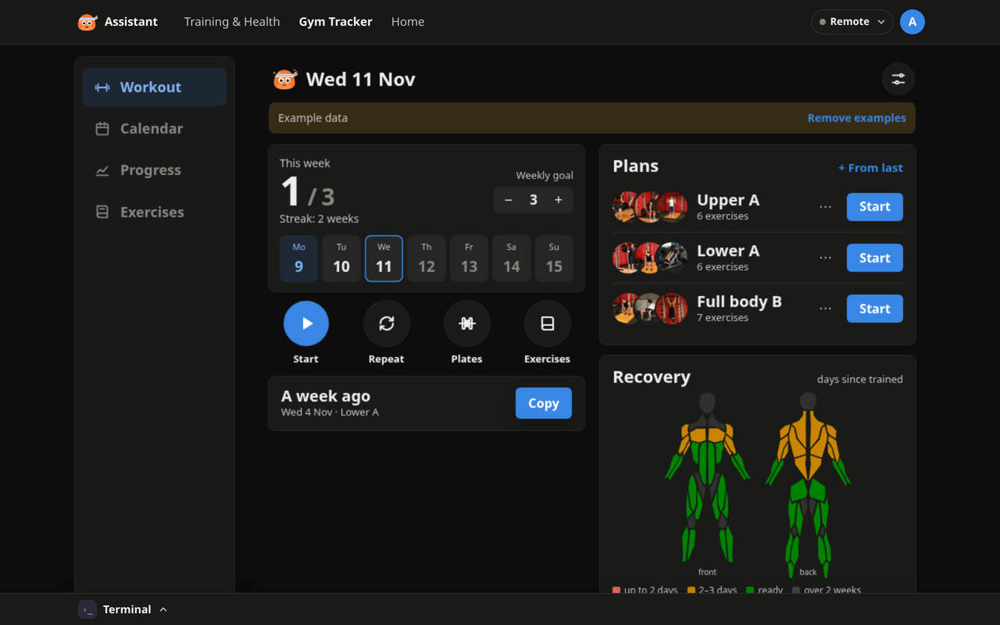
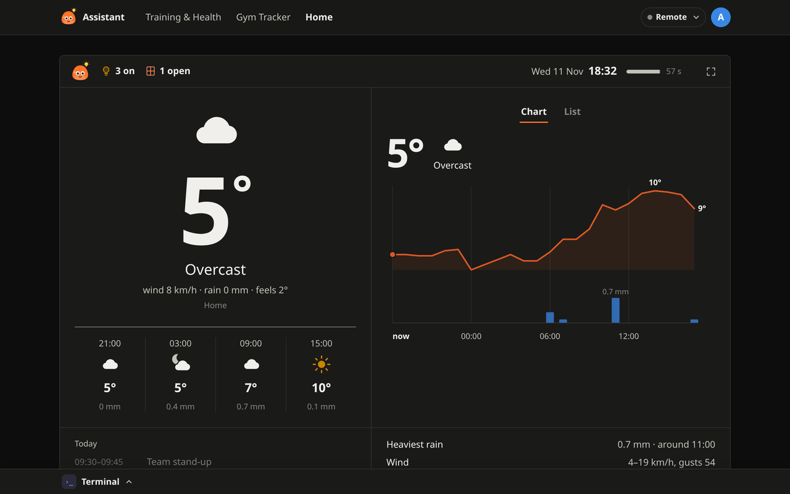
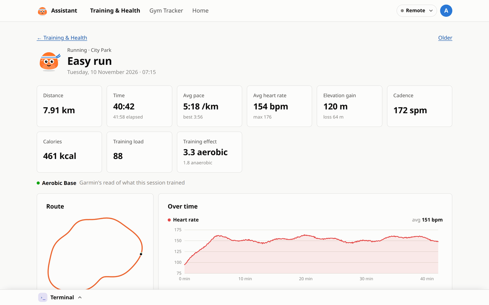
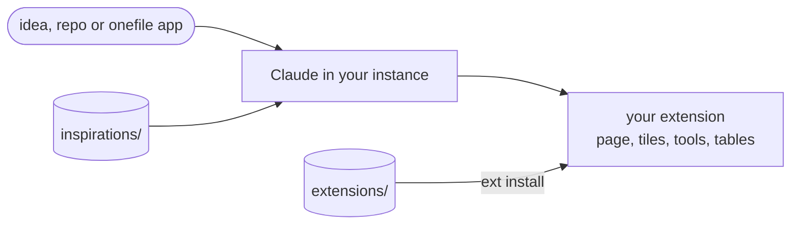

<div align="center">


# Beni Assistant extensions

Extensions for [Beni Assistant](https://github.com/b-niamin/assistant).
`extensions/` holds ones you install as they are; `inspirations/` holds skeletons Claude adapts into new ones.

[Ready to use](#ready-to-use) · [Inspirations](#inspirations) · [Install](#install) · [Write your own](#write-your-own)

</div>

## Ready to use

<table>
  <tr>
    <td width="33%" valign="top">
      <a href="docs/screenshots/health.png"></a>
      <h3><a href="extensions/health">Training &amp; Health</a></h3>
      Sleep, HRV, Body Battery, readiness and activities with route, laps and charts, synced from Garmin.<br />
      <sub><code>health</code> · native · per profile · needs a Garmin Connect account</sub>
    </td>
    <td width="33%" valign="top">
      <a href="docs/screenshots/gym.png"></a>
      <h3><a href="extensions/gym">Gym Tracker</a></h3>
      Workout plans, sets and weights, progress charts and a body map of trained muscles.<br />
      <sub><code>gym</code> · onefile · per profile</sub>
    </td>
    <td width="33%" valign="top">
      <a href="docs/screenshots/home.png"></a>
      <h3><a href="extensions/home">Home</a></h3>
      Lights on, open doors and windows, camera alerts, weather with warnings and today's calendar.<br />
      <sub><code>home</code> · native · shared · needs Home Assistant</sub>
    </td>
  </tr>
</table>

<details>
<summary>More screenshots, light and dark</summary>

| Light | Dark |
|---|---|
|  |  |
|  |  |
|  |  |

An activity in Training & Health:



</details>

<sub>Screenshots use demo data.</sub>

## Inspirations

Skeletons, not installed as they are. Claude copies one and changes it to fit.

| Inspiration | Example of |
|---|---|
| [`home-assistant`](inspirations/home-assistant) | Shared data and a settings panel with a secret token (`home` started from it) |
| [`calendar`](inspirations/calendar) | Shared data and dashboard tiles |
| [`learning`](inspirations/learning) | Per-profile data, dashboard tiles and a daily streak |

A repo, an app from [onefile-apps](https://github.com/b-niamin/onefile-apps) or a description works as
a starting point too. Claude writes the extension from scratch and records the source as `inspiredBy`.

## Install

With a new Beni Assistant:

```sh
curl -fsSL https://raw.githubusercontent.com/b-niamin/assistant/main/install.sh | sudo sh -s -- health gym home
```

In a running instance: **System settings → Extend the system**, or ask Claude *"add the gym tracker"*.
Command-line install and updates: [docs/install.md](docs/install.md).

## Write your own

Ask Claude in your instance, e.g. *"build me a habit tracker based on &lt;link&gt;"*. It starts from an
inspiration (`ext new <id> --from inspiration:<name>`) and uses the app's layout and components.



Folder layout: [docs/extension-layout.md](docs/extension-layout.md). Full contract:
[spec 002](https://github.com/b-niamin/assistant/blob/main/specs/002-extensions.md) in the core repo.
To publish an extension here, add its folder and an entry in [`catalog.json`](catalog.json).
