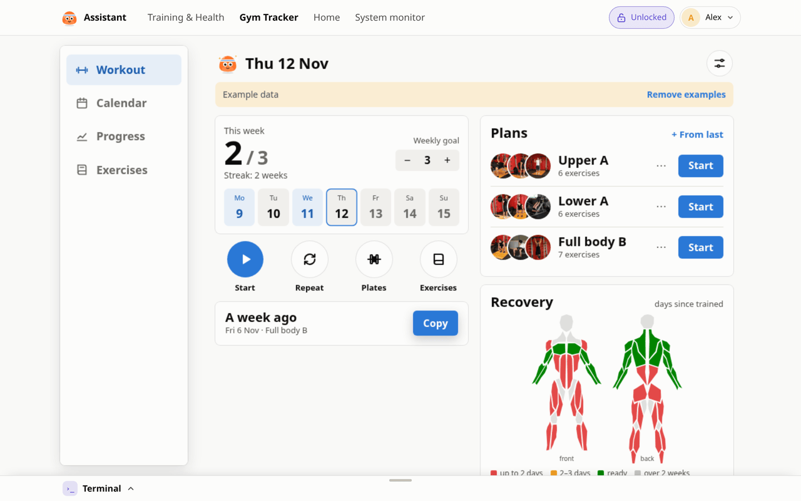

# Gym Tracker

Plan workouts, log sets and weights, track progress and see which muscles you trained on a body map.

## Features

- Workout plans, quick start or repeat the last session
- Log sets, reps and weight with suggestions from last time
- Timer on a round floating button, with a big 3/4-screen view, sound and vibration; screen stays on
- Exercise library with photos, nine simple categories and a low back pain set
- Progress charts, estimated 1RM, calendar
- Muscle map of what you trained, kg or lb, plate calculator
- Phone and desktop layout (side menu, two columns)

A onefile extension, per profile: each profile has its own log.

## Your data

The app keeps its log in `localStorage` (`gym-notebook.v1`); inside Beni the shell saves that to the
server, so the log follows the profile across devices and lands in the backups. Export and import as
JSON are in the app's menu.

## Tools for Claude

Claude reaches the log through the assistant's MCP server: `gym__overview` (plans, this week, recent
workouts with sets), `gym__log_workout` and `gym__save_plan` (`web/tools.server.ts`). Writes only add
workouts or plans and show up the next time the app opens.

## Updating from onefile-apps

The app is the Gym Tracker from [onefile-apps](https://github.com/b-niamin/onefile-apps/tree/main/apps/gym-tracker/muscle-map)
in the assistant's look. To bring in upstream changes, clone that repo and run
`python3 sync-from-onefile.py <onefile-apps>/apps/gym-tracker/muscle-map/src`; it rebuilds `app.html`.

## Credits

- Author: [@piotr-liszka](https://github.com/piotr-liszka). MIT license. [Changelog](CHANGELOG.md)
- [react-body-highlighter](https://github.com/giavinh79/react-body-highlighter) (MIT): muscle map shapes
- [Free Exercise DB](https://github.com/yuhonas/free-exercise-db) (Unlicense): exercise photos, embedded in `app.html`
